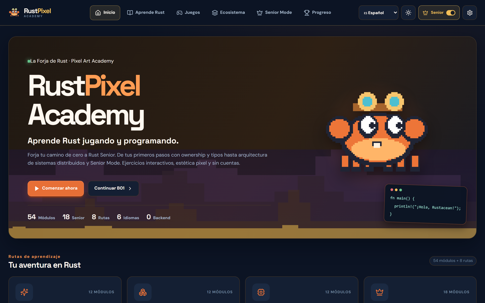
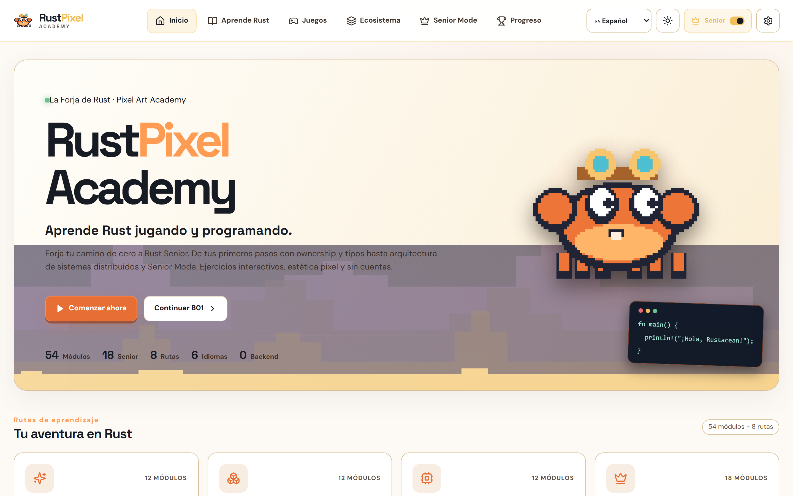
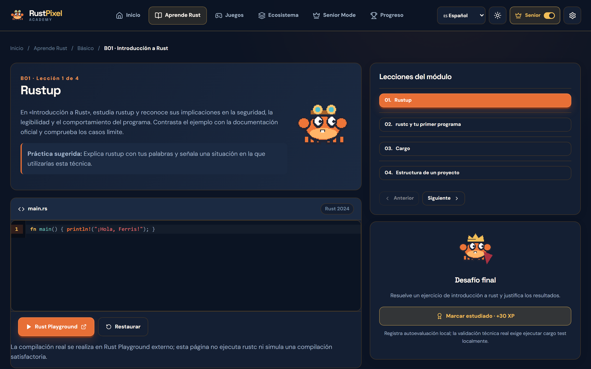
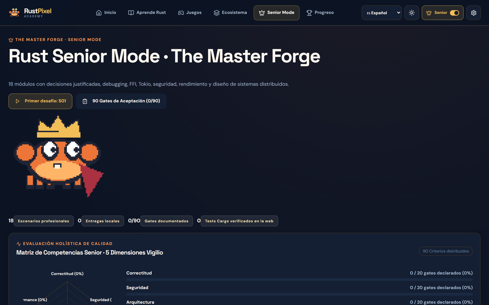
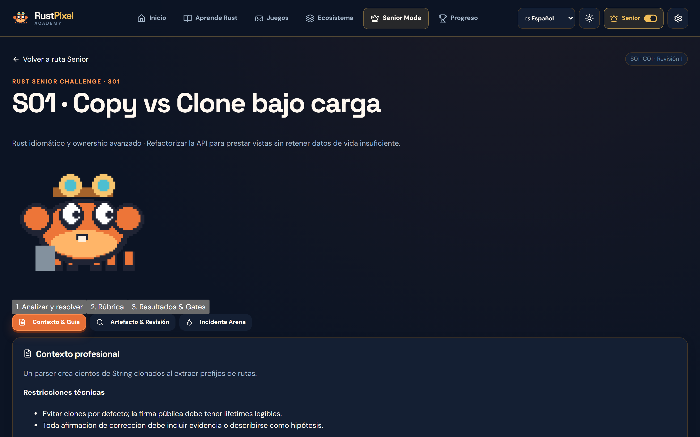
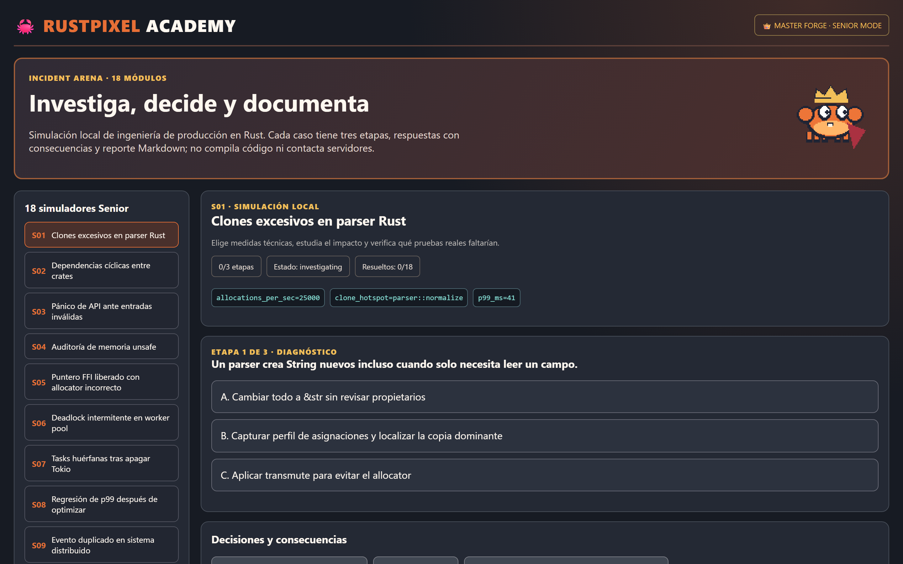
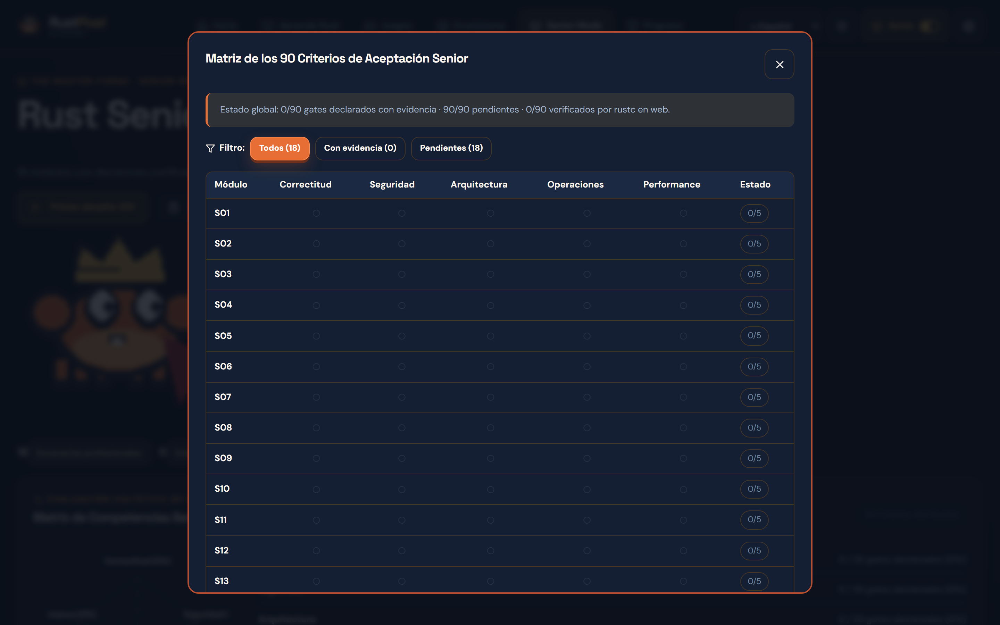
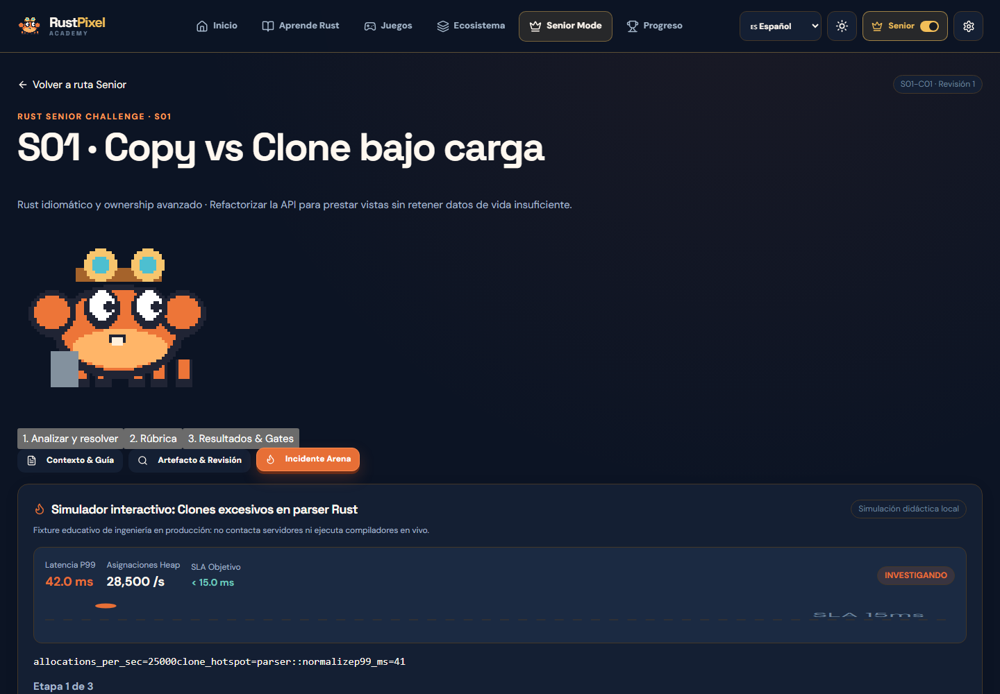
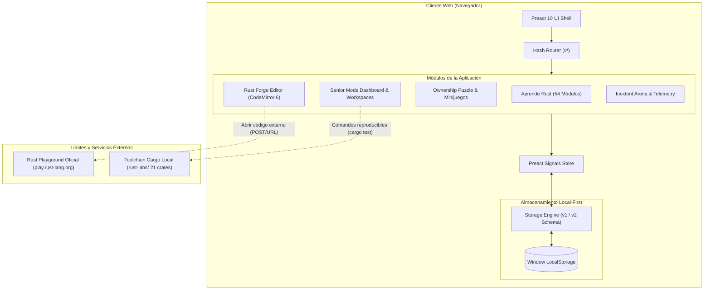

# 🦀 RustPixel Academy

[](https://vigilioyonatan.github.io/rustpixel-academy/)
[](https://github.com/VigilioYonatan/rustpixel-academy/actions)
[](file:///docs/architecture/ARCHITECTURE.md)
[](file:///package.json)
[](file:///biome.json)
[](file:///src/)
[](file:///LICENSE)

> **Plataforma interactiva de maestría en Rust.** Desde los fundamentos de *Ownership*, *Borrow Checker* y concurrencia segura hasta Arquitectura Senior de Sistemas, Incident Arena con telemetría en tiempo real, Visor de Diferencias (Diff) y Matriz de 90 Criterios de Aceptación para producción.

🌐 **Aplicación en Producción:** [https://vigilioyonatan.github.io/rustpixel-academy/](https://vigilioyonatan.github.io/rustpixel-academy/)

---

## 📑 Tabla de Contenidos

1. [Visión General y Capacidades](#-visión-general-y-capacidades)
2. [Visual Showcase & Demos Interactivas](#-visual-showcase--demos-interactivas)
3. [Stack Tecnológico y Estándares](#-stack-tecnológico-y-estándares)
4. [Arquitectura del Sistema y Flujo de Datos](#-arquitectura-del-sistema-y-flujo-de-datos)
5. [Estructura del Repositorio](#-estructura-del-repositorio)
6. [Quick Start (< 5 minutos)](#-quick-start--5-minutos)
7. [Variables de Entorno](#-variables-de-entorno)
8. [Límites de Ejecución y Runtimes](#-límites-de-ejecución-y-runtimes)
9. [Estrategia de Pruebas y Quality Gates](#-estrategia-de-pruebas-y-quality-gates)
10. [Pipeline de CI/CD y Despliegue](#-pipeline-de-cicd-y-despliegue)
11. [Checklist del Desarrollador Senior](#-checklist-del-desarrollador-senior)
12. [Solución de Problemas Frecuentes](#-solución-de-problemas-frecuentes)
13. [Gobernanza y Autoría](#-gobernanza-y-autoría)
14. [Licencia](#-licencia)

---

## 🚀 Visión General y Capacidades

RustPixel Academy resuelve el salto cognitivo que experimentan los ingenieros al aprender Rust: la transición entre memorizar sintaxis básica y tomar decisiones arquitectónicas de nivel Senior en sistemas concurrentes, sin recolectar PII ni requerir infraestructura de backend propietaria.

### 🌟 Capacidades Principales

- **54 Módulos Curriculares Estructurados:** Divididos en niveles Básico (B01–B12), Intermedio (I01–I12), Avanzado (A01–A12) y Especialización Senior (S01–S18).
- **Editor de Código Rust Forge (CodeMirror 6):** Entorno de edición en el navegador con tema oscuro de alto contraste personalizado (`#0b1423`), coloreado sintáctico calibrado para legibilidad Senior (`fn`, macros, lifetimes, mutabilidad), restauración instantánea y enlace directo a Rust Playground oficial.
- **Senior Engineering Mode (18 Desafíos Profesionales):**
  - **Radar Pentagonal SVG:** Evaluación visual en 5 dimensiones Vigilio (Corrección, Seguridad, Arquitectura, Operaciones, Rendimiento).
  - **Incident Arena:** Simulador de incidentes de producción con telemetría dinámica (*sparkline* en tiempo real, latencias P99, degradación de SLAs y árbol de decisiones de mitigación).
  - **Visor de Diferencias Senior (Diff Viewer):** Comparador visual reactivo entre el código defectuoso (*baseline*) y la refactorización Senior sugerida.
  - **Matriz de 90 Gates de Aceptación:** Auditoría interactiva de 90 criterios de producción con exportación de informes en Markdown.
  - **Workspaces Especializados:** Herramientas de *Code Review* interactivo por línea y diseño de sistemas (*Architecture ADR Canvas*).
- **Visualizador Semántico de Ownership & Préstamos:** Laboratorio interactivo para comprender movimientos de memoria en Stack vs. Heap y resolución de préstamos sin garbage collector.
- **8 Rutas del Ecosistema Rust:** Guías especializadas para Backend Web, Asincronía con Tokio, CLIs, Sistemas Embebidos, Criptografía, Motores de Juegos y Data Engineering.
- **Internacionalización Completa (i18n en 6 Idiomas):** Navegación y estructura en Español, Inglés, Francés, Alemán, Portugués e Italiano.
- **Arquitectura Local-First y Cero Rastreo:** Persistencia local versionada en `localStorage`, copias de respaldo JSON validadas y total independencia de servidores de terceros.

---

## 📸 Visual Showcase & Demos Interactivas

La interfaz sigue los principios de diseño de Vigilio: estética Pixel Forge oscura, tipografía monoespaciada para ingeniería, iconos vectoriales SVG limpios (`lucide-preact`) y cero emojis decorativos en componentes operativos.

| Home & Experiencia Inicial | Modo Claro / Modo Oscuro |
| :---: | :---: |
|  |  |

| Editor Rust Forge (CodeMirror 6) | Dashboard Senior & Radar Pentagonal |
| :---: | :---: |
|  |  |

| Senior Challenge & Diff Viewer | Incident Arena & Telemetría en Vivo |
| :---: | :---: |
|  |  |

| Matriz de 90 Gates de Aceptación | Telemetría Sparkline & SLA |
| :---: | :---: |
|  |  |

### 🎥 Demostración Completa en Video

El flujo completo de navegación, edición de código con el nuevo tema Rust Forge, resolución de incidentes y visor de diffs se encuentra grabado en alta fidelidad:

- 📹 **Video del Showcase:** [`screenshots/videos/rustpixel-academy-showcase.webm`](file:///screenshots/videos/rustpixel-academy-showcase.webm)

---

## 🛠 Stack Tecnológico y Estándares

El proyecto está diseñado bajo una arquitectura de Single Page Application (SPA) sin backend, garantizando despliegue estático gratuito, latencia cero y máxima disponibilidad.

| Capa | Tecnología | Propósito Arquitectónico | Fuente de Verdad |
|---|---|---|---|
| **Runtime & Toolchain** | Node.js / npm | Entorno de construcción, linting y pruebas | [`package.json#engines`](file:///package.json#L44-L46) |
| **Framework UI** | Preact 10.x | Núcleo de componentes reactivos ultraligero (< 4kB) | [`package.json#dependencies`](file:///package.json#L32) |
| **Gestión de Estado** | `@preact/signals` | Reactividad granular sin re-renders globales innecesarios | [`package.json#dependencies`](file:///package.json#L27) |
| **Editor de Código** | CodeMirror 6 | Editor profesional extensible con resaltado Rust Forge | [`package.json#dependencies`](file:///package.json#L28-L31) |
| **Iconografía** | `lucide-preact` | Iconos vectoriales accesibles (cero emojis en UI operativa) | [`package.json#dependencies`](file:///package.json#L33) |
| **Bundler & Dev Server** | Vite 6.x | Empaquetado optimizado, HMR instantáneo y build estático | [`package.json#devDependencies`](file:///package.json#L42) |
| **Linter & Formatter** | Biome 1.9.x | Calidad de código y formato conforme a Vigilio Standards | [`package.json#devDependencies`](file:///package.json#L36) |
| **Testing Unitario** | Vitest 3.x | Suite de pruebas unitarias y de dominio en memoria | [`package.json#devDependencies`](file:///package.json#L43) |
| **Testing E2E & Video** | Playwright Chromium | Automatización de flujos completos y grabación de video | [`package.json#devDependencies`](file:///package.json#L38) |
| **Laboratorios Rust** | Cargo 2024 Edition | 21 crates autocontenidos para validación local nativa | [`rust-labs/`](file:///rust-labs/) |

> [!NOTE]
> Conforme al principio *Single Source of Truth* de Vigilio, las versiones exactas de las librerías se consultan exclusivamente en `package.json` y `package-lock.json`. No se permiten versiones hardcodeadas en texto de documentación.

---

## 📐 Arquitectura del Sistema y Flujo de Datos



### Principios de Diseño Arquitectónico

1. **Local-First & Offline Capable:** Los avances, notas de incidentes, rúbricas de autoevaluación y preferencias de tema se conservan íntegramente en el navegador del usuario bajo esquemas versionados.
2. **Límite Transparente de Compilación:** La SPA **no simula falsamente un compilador Rust en el navegador**. La ejecución de código se delega explícitamente a:
   - El compilador oficial remoto vía enlace a [Rust Playground](https://play.rust-lang.org/).
   - El toolchain local del ingeniero a través de los laboratorios [`rust-labs/`](file:///rust-labs/).
3. **Inmutabilidad y Trazabilidad:** Cada entrega Senior genera un historial de intentos con sellos de tiempo, comandos de auditoría y métricas de desempeño reproducibles.

---

## 📂 Estructura del Repositorio

El repositorio organiza sus responsabilidades según los patrones de modularidad y ownership de Vigilio:

```text
rustpixel-academy/
├── .github/
│   └── workflows/              # Automatización CI/CD (lint, tests, build, deploy)
│       ├── ci.yml              # Quality gates automáticos en push y pull_request
│       └── deploy.yml          # Despliegue estático continuo a GitHub Pages
├── docs/                       # Documentación de arquitectura y guías de ingeniería
│   ├── architecture/           # Decisiones de diseño y ADRs
│   └── senior/                 # Rúbricas de evaluación, matriz de gates y evidencias
├── public/                     # Activos estáticos públicos
│   └── assets/                 # Fondos pixel art, sprites de Ferris e iconos
├── rust-labs/                  # 21 crates Cargo autocontenidos para validación local
│   ├── S01-memory-layout/      # Laboratorio Senior 01 (Allocaciones y slices)
│   ├── S02-workspace-crates/   # Laboratorio Senior 02 (Arquitectura de crates)
│   └── ...                     # S03 a S18 laboratorios de sistemas concurrentes
├── screenshots/                # Capturas de verificación Retina y videos showcase
│   ├── showcase/               # Capturas oficiales de alta resolución para README
│   └── videos/                 # Grabación de showcase en Senior Mode (.webm)
├── scripts/                    # Scripts de automatización, verificación y E2E
│   ├── record-showcase-video.mjs # Grabador automatizado con Playwright
│   ├── verify-all-selects.mjs  # Validación exhaustiva de selects y formularios
│   └── test-master-e2e.mjs     # Suite de pruebas E2E en navegador
├── src/                        # Código fuente de la SPA Preact
│   ├── app/                    # Shell de aplicación, router hash y layout principal
│   ├── content/                # Definición de temarios, preguntas y guías de campo
│   ├── features/               # Lógica de dominio modular
│   │   ├── ecosystem/          # 8 Rutas del ecosistema Rust
│   │   ├── games/              # Mecánicas interactivas y Ownership Puzzle
│   │   ├── learning/           # Motor de lecciones y catálogo curricular
│   │   └── senior/             # Motor Senior (Incidentes, Diff, Radar, Gates)
│   ├── i18n/                   # Traducciones de interfaz en 6 idiomas
│   └── styles/                 # Tokens CSS Pixel Forge y estilos de CodeMirror
├── index.html                  # Punto de entrada HTML de la SPA
├── package.json                # Dependencias, scripts y metadatos de engines
├── biome.json                  # Reglas de linting y formateo estricto
└── vite.config.ts              # Configuración de empaquetado y base path para Pages
```

---

## ⚡ Quick Start (< 5 minutos)

Sigue estos pasos para clonar, instalar dependencias y tener la academia ejecutándose en local en menos de cinco minutos:

### 1. Prerrequisitos

- **Node.js:** Versión compatible con [`package.json#engines`](file:///package.json#L44-L46) (`>= 20.19.0`).
- **npm:** Gestor de paquetes incluido con Node.js.
- **Git:** Para clonar el repositorio.

### 2. Clonado e Instalación

```bash
# 1. Clonar el repositorio
git clone https://github.com/VigilioYonatan/rustpixel-academy.git
cd rustpixel-academy

# 2. Instalar dependencias limpias desde package-lock.json
npm ci
```

### 3. Ejecución en Modo Desarrollo

```bash
# Iniciar el servidor local de desarrollo con Vite
npm run dev
```

La consola mostrará la URL de acceso local:

```text
  VITE v6.x.x  ready in 250 ms

  ➜  Local:   http://localhost:5174/
  ➜  Network: use --host to expose
```

Abre [`http://localhost:5174/`](http://localhost:5174/) en tu navegador para interactuar con la academia.

---

## 🔐 Variables de Entorno

Al ser una arquitectura Static SPA con persistencia *local-first*, la aplicación **no requiere claves de API privadas ni credenciales de backend**:

| Variable | Tipo | Default | Requerida | Propósito Arquitectónico |
|---|---|---|---|---|
| `GITHUB_PAGES` | `boolean` | `false` | No | Si es `true`, Vite configura el `base` para servir desde `/rustpixel-academy/`. |
| `BASE_URL` | `string` | `'/'` | No | Ruta base calculada automáticamente por Vite durante el build. |

> [!CAUTION]
> **Cero Secretos:** Nunca agregues tokens de GitHub, llaves privadas ni contraseñas al repositorio o a archivos `.env`. Toda la persistencia es local en el navegador del usuario.

---

## 🛡 Límites de Ejecución y Runtimes

Para mantener la integridad técnica y la honestidad pedagógica, RustPixel Academy establece límites de responsabilidad claros:

```
┌────────────────────────────────────────────────────────────────────────┐
│                        NIVEL 1: NAVEGADOR (SPA)                        │
│  - Renderizado Preact + Signals a 60 FPS                                │
│  - Editor CodeMirror 6 con coloreado de sintaxis Rust Forge            │
│  - Inspección de Diff de código (Baseline vs. Solución Senior)          │
│  - Simulación de incidentes, telemetría y matriz de 90 gates           │
│  - Persistencia segura y versionada en LocalStorage                    │
└────────────────────────────────────────────────────────────────────────┘
                                    │
                  ┌─────────────────┴─────────────────┐
                  ▼                                   ▼
┌───────────────────────────────────┐ ┌───────────────────────────────────┐
│     NIVEL 2: PLAYGROUND OFICIAL   │ │      NIVEL 3: CARGO NATIVO        │
│  - Ejecución remota de snippets   │ │  - 21 laboratorios en rust-labs/  │
│  - Redirección con POST seguro    │ │  - Compilación nativa con rustc   │
│  - Sin secretos ni proxies        │ │  - Benchmarks y cargo clippy real │
└───────────────────────────────────┘ └───────────────────────────────────┘
```

---

## 🧪 Estrategia de Pruebas y Quality Gates

El repositorio incluye validaciones automáticas exhaustivas que deben superarse antes de cualquier despliegue:

```bash
# 1. Verificación de integridad de contenidos curriculares
npm run content:check

# 2. Validación de coherencia del Motor Senior (18 retos, incidentes y gates)
npm run senior:check

# 3. Linter y formateador estricto con Biome
npm run lint

# 4. Comprobación estricta de tipos con el compilador TypeScript
npm run typecheck

# 5. Ejecución de la suite de pruebas unitarias y de dominio con Vitest
npm test

# 6. Compilación de producción estática
npm run build
```

---

## 🚀 Pipeline de CI/CD y Despliegue

La integración y el despliegue continuos están automatizados mediante GitHub Actions:

- **`.github/workflows/ci.yml` (Quality Gate):** Se dispara en cada `push` a la rama `main` y en `pull_request`. Ejecuta validación de contenido, linter de Biome, typecheck estricto, pruebas Vitest y compilación de producción. Si alguna prueba falla, el pipeline bloquea la fusión.
- **`.github/workflows/deploy.yml` (Publicación a GitHub Pages):** Cuando el commit pasa todos los quality gates en `main`, Vite compila la SPA con `GITHUB_PAGES=true` y publica los artefactos en GitHub Pages utilizando la acción oficial `actions/deploy-pages`.

---

## ✅ Checklist del Desarrollador Senior

Antes de abrir un Pull Request o autorizar un release, verifica:

- [x] **Cero Emojis como Iconos:** Todos los iconos de navegación, botones y tarjetas deben ser componentes vectoriales SVG de `lucide-preact`.
- [x] **Cero Versiones Hardcodeadas en Markdown:** La única fuente de verdad es `package.json`.
- [x] **Cero Secretos:** Ningún archivo `.env` con credenciales reales en el árbol git.
- [x] **Contraste Accesible:** La paleta Rust Forge en modo oscuro (`#0b1423`) y modo claro cumple con las pautas WCAG 2.1 AA.
- [x] **Trazabilidad de Gates:** Cualquier modificación en el motor Senior debe reflejarse en los 90 Criterios de Aceptación y pasar `npm run senior:check`.
- [x] **100% de Pruebas Verificadas:** `npm test` y `npm run lint` ejecutan con 0 errores y 0 advertencias.

---

## ❓ Solución de Problemas Frecuentes

### 1. El puerto 5173 o 5174 ya está en uso
Si otra instancia de Vite se encuentra activa en el puerto por defecto, Vite seleccionará automáticamente el siguiente disponible (ej. 5174 o 5175). Puedes forzar un puerto específico en la terminal:
```bash
npx vite --port 5174 --strictPort
```

### 2. Error 404 al recargar rutas en GitHub Pages
La aplicación utiliza un enrutador basado en Hash (`HashRouter` con formato `#/module/B01` y `#/challenge/S01-C01`). No intentes utilizar rutas directas HTML5 sin hash en GitHub Pages estático, ya que el servidor web de GitHub no posee reglas de reescritura hacia `index.html`.

### 3. Restablecimiento del Estado Local (LocalStorage)
Si deseas reiniciar todo el progreso y las notas de incidentes a su estado de fábrica:
1. Abre las Herramientas de Desarrollador del navegador (F12) → Pestaña *Application* (o *Almacenamiento*).
2. Selecciona *Local Storage* → `http://localhost:5174` (o la URL de producción).
3. Haz clic en *Clear* o ejecuta en la consola:
   ```javascript
   localStorage.clear();
   location.reload();
   ```

---

## 👥 Gobernanza y Autoría

- **Arquitectura y Desarrollo:** Desarrollado por **Yonatan Vigilio** bajo los estándares de ingeniería y gobernanza técnica de **Vigilio Engineering Docs**.
- **Aviso de Marcas:** Rust es una marca registrada de la **Rust Foundation**. Este proyecto es una iniciativa educativa independiente de código abierto y no cuenta con afiliación oficial ni patrocinio de la Rust Foundation.

---

## 📄 Licencia

Este proyecto se distribuye bajo los términos de la licencia **MIT**. Consulta el archivo [`LICENSE`](file:///LICENSE) para obtener más información.
